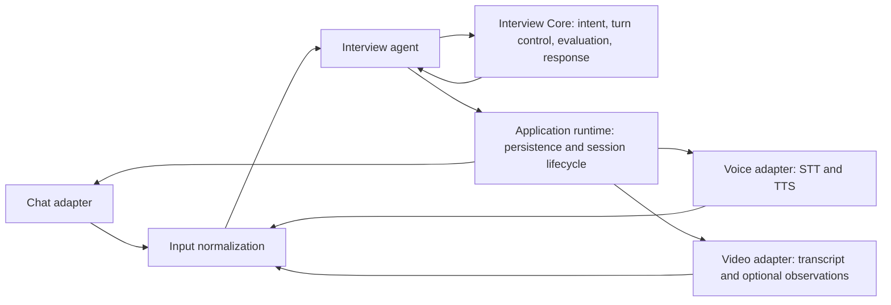

# Interview module architecture

The three interview modes share one assessment flow. Adapters normalize input and deliver output; they do not own question selection, turn decisions, or scoring.



## Responsibilities

- `core/` owns behavior common to all modalities: turn state, evaluation rules, question response policy, and channel-neutral interviewer dialogue.
- `core/conversation/` owns the turn engine, response generation, and turn rules used for every modality.
- `core/contracts/` defines the shared interview input, output, stage, and action types.
- `core/session_policy/` defines the shared stage, timing, and demo-session rules.
- `core/dialogue/` owns shared dialogue policy, phrases, opening, language checks, playbook lessons, and speech-check diagnostics. It contains no STT, TTS, camera behavior, pronunciation, or audio recovery.
- `planning/` builds and selects the interview plan from candidate, CV, JD, matching, and question bank data.
- `agent/` receives one normalized candidate turn and invokes Core.
- `adapters/chat/input/turn_input.py`, `adapters/voice/input/turn_input.py`, and `adapters/video_calls/input/turn_input.py` map each modality to the same agent request contract. Voice accepts only a final transcript; partial STT is not an answer.
- Each modality package separates `api/` transport from `input/` normalization. Voice additionally groups `api/` endpoints, `runtime/` LiveKit worker, `stt/`, `tts/`, `speech/`, `conversation/`, and `config/`. Voice owns transcription, transcript cleanup, answer buffering, audio turn taking, pronunciation, synthesis, and voice-only recovery phrases. Video observations remain telemetry unless an explicit assessment rule is added to Core.
- `application/runtime/` persists sessions and coordinates Core calls. `chat_runtime.py` is historically named; Voice and Video use this same runtime path.
- `application/quality_admin/` reports settings, traces, and reviewed quality data.

## Layout

```text
interviews/
|-- adapters/
|   |-- chat/                  # api/router.py, input/turn_input.py
|   |-- video_calls/           # api/router.py, api/signaling.py, input/turn_input.py
|   `-- voice/
|       |-- input/             # normalized final transcripts
|       |-- api/               # router.py, Voice Lab endpoints
|       |-- runtime/           # LiveKit agent worker
|       |-- conversation/      # answer window, interruptions, events, phrases
|       |-- stt/               # providers, recognition, transcript cleanup/evaluation
|       |-- tts/               # providers, cache, pronunciation dictionaries
|       |-- speech/            # language normalization and speech formatting
|       `-- config/            # voice tuning
|-- agent/                     # shared request/response boundary
|-- application/
|   |-- quality_admin/
|   `-- runtime/               # shared persistence/runtime path
|-- core/
|   |-- conversation/          # turn_engine.py, response_generation.py, turn_rules.py
|   |-- contracts/             # interview.py
|   |-- session_policy/       # blueprint.py, demo_mode.py
|   `-- dialogue/              # policy.py, phrases.py, opening.py, language.py, playbook.py, speech_checks.py
|-- evaluation/
`-- planning/
```

## Change rule

Change what the interviewer asks, how it handles an answer, or how it scores in Core so all modes behave consistently. Change an adapter only for transport, transcription, audio/video presentation, or channel-specific recovery. Remove a file only after checking imports, tests, scripts, and deployment entry points.
