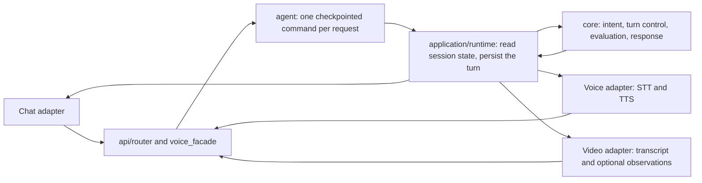

# Interview module architecture

The three interview modes share one assessment flow. Adapters normalize input and deliver output; they do not own question selection, turn decisions, or scoring.



The path of one candidate turn, as the code runs it (verified 2026-11-24):

```text
router / voice_facade
  → application/runtime/agent_runtime.run_interview_command("respond")
    → agent.session_workflow.InterviewCommandRunner.execute
                                             thread = (session, command, client_message_id); replay if completed
      → operations["respond"]              closure bound to the request's db session
        → chat_runtime.process_candidate_message
            build_session_state_from_db → CandidateTurnInput
            → agent.interviewer.interview_agent.run_turn (turn graph and model decision)
              → core InterviewCoreEngine                  (guards, action handlers, output checks)
            persist messages, turn status, stage
```

Every modality submits the same ``core.contracts.interview.CandidateTurnInput``; there is
no second turn contract. The per-turn Interviewer Agent is separate from the durable
session-command workflow. ``agent/planner/PlannerAgent`` now owns prepare/freeze
orchestration and drafts the CV-grounded verification question. P1 planning,
CV project evidence, P2 selection, validation, and freeze modules now live in
``agent/planner/``. The deterministic entry gate and job-level Question Bank
coverage/generation workflows remain in ``planning/``. P2 no longer generates
Question Bank entries. A worker proposes review-only drafts from recorded gaps
after the session has closed and been scored.

For CV project evidence, P1 gives the Planner Agent the candidate's project
fields and job requirements through `submit_project_evidence`. The model may
propose claims and requirement links, but code accepts a claim only when its
quote is an exact substring of the matching CV project and its IDs are known.
Code scores and persists the validated evidence with the SQL plan. P2 reuses
that snapshot; no regex extractor or second model extraction pass remains.
Provider failure yields no structured project evidence and is traced.

For P1/P2, the Planner Agent may propose an ordering of code-derived competency
targets and select among code-filtered Question Bank candidates/feasible
subsets. The SQL-frozen Admin contract is included in both proposals. Code
validates each answer, enforces coverage/budget/uniqueness and freezes the
queue; invalid proposals use deterministic selection and are traced.
Planner orchestration is a compiled LangGraph. P1 uses the bounded
`rank_competency_targets` function tool; P2 uses a LangGraph tool loop with
read-only `search_question_bank` and validated
`submit_question_bank_selection` tools. The graph has no checkpoint because
the SQL plan and frozen queue are the durable state.

## Responsibilities

- `core/` owns behavior common to all modalities: turn state, evaluation rules, question response policy, and channel-neutral interviewer dialogue.
- `core/conversation/` owns the turn engine, response generation, and turn rules used for every modality.
- `core/contracts/` defines the shared interview input, output, stage, and action types.
- `core/session_policy/` defines the shared stage, timing, and demo-session rules.
- `core/dialogue/` owns shared dialogue policy, phrases, opening, language checks, playbook lessons, and speech-check diagnostics. It contains no STT, TTS, camera behavior, pronunciation, or audio recovery.
- `planning/` provides the deterministic entry gate and Question Bank coverage/generation workflows.
- `agent/session_workflow/` runs the six session commands (`prepare`, `freeze`, `open`, `respond`, `finish`, `score`) on one compiled graph with a Postgres checkpoint per `(session, command, event)`. `InterviewCommandRunner` is workflow infrastructure, not an AI agent; operations arrive per call from `application/runtime/agent_runtime.py`.
- `agent/interviewer/` owns per-turn agent decision, menu, pacing, turn graph, decision record, and spoken-question drafting. `interview_agent.py` is the graph entry point for one candidate turn; Core owns shared guards, action handlers, and output checks.
- `agent/planner/` owns P1 plan construction, CV project evidence, P2 selection/validation/freeze, prepare/freeze orchestration, and CV-grounded question drafting.
- `application/runtime/spoken_questions.py` persists validated spoken variants produced by the Interviewer Agent before the session opens.
- `application/background/question_suggestions.py` queues Question Bank drafts for uncovered targets after close/score; drafts still require admin review.
- `agent/shared/` contains infrastructure shared across the workflows, currently the Postgres checkpointer/store lifecycle.
- Adapters normalise their input into `CandidateTurnInput` where they call the runtime. Voice accepts only a final transcript; partial STT is not an answer.
- Each modality package keeps `api/` transport. Voice additionally groups `api/` endpoints, `runtime/` LiveKit worker, `stt/`, `tts/`, `speech/`, `conversation/`, and `config/`. Voice owns transcription, transcript cleanup, answer buffering, audio turn taking, pronunciation, synthesis, and voice-only recovery phrases. Video observations remain telemetry unless an explicit assessment rule is added to Core.
- `application/runtime/` persists sessions and coordinates Core calls. `chat_runtime.py` is historically named; Voice and Video use this same runtime path.
- `application/quality_admin/` reports settings, traces, and reviewed quality data.

## Layout

```text
interviews/
|-- adapters/
|   |-- chat/                  # api/router.py
|   |-- video_calls/           # api/router.py, api/signaling.py
|   `-- voice/
|       |-- api/               # router.py, Voice Lab endpoints
|       |-- runtime/           # LiveKit agent worker
|       |-- conversation/      # answer window, interruptions, events, phrases
|       |-- stt/               # providers, recognition, transcript cleanup/evaluation
|       |-- tts/               # providers, cache, pronunciation dictionaries
|       |-- speech/            # language normalization and speech formatting
|       `-- config/            # voice tuning
|-- agent/
|   |-- interviewer/           # interview_agent.py (one-turn graph), decide.py, menu.py,
|   |                          # pacing.py, tools.py, record.py, state.py
|   |-- planner/               # P1/P2 tools + PlannerAgent orchestration + CV question capability
|   |-- session_workflow/      # command_runner.py, graph.py, ports.py, state.py
|   `-- shared/                # checkpoints.py (Postgres checkpointer + candidate-memory store)
|                              # candidate memory itself: application/runtime/candidate_memory.py
|                              # (store rows in langmem's {kind, content} envelope; extractor = langmem)
|-- application/
|   |-- quality_admin/
|   `-- runtime/               # shared persistence/runtime path
|-- core/
|   |-- conversation/          # turn_engine.py, response_generation.py, turn_rules.py
|   |-- contracts/             # interview.py
|   |-- session_policy/       # blueprint.py, demo_mode.py
|   `-- dialogue/              # policy.py, phrases.py, opening.py, language.py, playbook.py, speech_checks.py
|-- evaluation/
`-- planning/                  # entry gate + Question Bank coverage/generation workflows
```

## Agent modes and flags (INTERVIEW_AGENT_DECISION_PLAN_V1)

| Env | Values | Effect |
|---|---|---|
| `INTERVIEW_AGENT_MODE` | `rule` (default) / `shadow` / `live` | `rule`: the rule ladder decides. `shadow`: the rule executes and the model choice is recorded. `live`: the model executes any valid action in the code-built menu; invalid, out-of-menu, or failed decisions fall back to the rule path. |
| `INTERVIEW_CANDIDATE_MEMORY` | `0` (default) / `read` / `readwrite` | `read`: seed from the gap notebook at `open`, load topics into the prompts, offer `search_candidate_memory` to the decider. `readwrite`: also extract after `score` with the `langmem` memory manager (extra `memory`); every model call it makes is an `ai_call_logs` row and the run is one Langfuse generation. |

Every turn carries `metadata["decision"]` (menu, pacing, rule choice, model choice, agreement) and emits the `agent_decision` pipeline event; `scripts/eval/interviews/agent_shadow_report.py` reads them.

## Change rule

Change what the interviewer asks, how it handles an answer, or how it scores in Core so all modes behave consistently. Change an adapter only for transport, transcription, audio/video presentation, or channel-specific recovery. Remove a file only after checking imports, tests, scripts, and deployment entry points.
