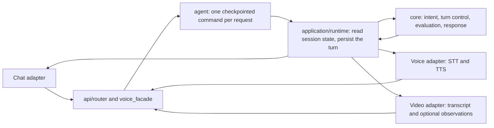

# Interview module architecture

The three interview modes share one assessment flow. Adapters normalize input and deliver output; they do not own question selection, turn decisions, or scoring.



The path of one candidate turn, as the code runs it (verified 2026-11-24):

```text
router / voice_facade
  → application/runtime/agent_runtime.run_interview_command("respond")
    → agent.InterviewAgent.execute         thread = (session, command, client_message_id); replay if completed
      → operations["respond"]              closure bound to the request's db session
        → chat_runtime.process_candidate_message
            build_session_state_from_db → CandidateTurnInput
            → core InterviewCoreEngine.handle_turn      (the decision; 1–3 model calls)
            persist messages, turn status, stage
```

Every modality submits the same ``core.contracts.interview.CandidateTurnInput``; there is
no second turn contract. Decision-making by the model (menu, decide, guards) is being
introduced by DOC_AND_PLAN/plan/INTERVIEW_AGENT_DECISION_PLAN_V1.md; until Pha 3 of that
plan the engine decides and the agent only makes the command durable and idempotent.

## Responsibilities

- `core/` owns behavior common to all modalities: turn state, evaluation rules, question response policy, and channel-neutral interviewer dialogue.
- `core/conversation/` owns the turn engine, response generation, and turn rules used for every modality.
- `core/contracts/` defines the shared interview input, output, stage, and action types.
- `core/session_policy/` defines the shared stage, timing, and demo-session rules.
- `core/dialogue/` owns shared dialogue policy, phrases, opening, language checks, playbook lessons, and speech-check diagnostics. It contains no STT, TTS, camera behavior, pronunciation, or audio recovery.
- `planning/` builds and selects the interview plan from candidate, CV, JD, matching, and question bank data.
- `agent/` runs the six session commands (`prepare`, `freeze`, `open`, `respond`, `finish`, `score`) on one compiled LangGraph graph with a Postgres checkpoint per `(session, command, event)`: a resent candidate message is answered from the checkpoint, never graded twice. It holds no business logic and no database session; operations arrive per call from `application/runtime/agent_runtime.py`.
- Adapters normalise their input into `CandidateTurnInput` where they call the runtime. Voice accepts only a final transcript; partial STT is not an answer.
- Each modality package keeps `api/` transport. Voice additionally groups `api/` endpoints, `runtime/` LiveKit worker, `stt/`, `tts/`, `speech/`, `conversation/`, and `config/`. Voice owns transcription, transcript cleanup, answer buffering, audio turn taking, pronunciation, synthesis, and voice-only recovery phrases. Video observations remain telemetry unless an explicit assessment rule is added to Core.
- `application/runtime/` persists sessions and coordinates Core calls. `chat_runtime.py` is historically named; Voice and Video use this same runtime path.
- `application/quality_admin/` reports settings, traces, and reviewed quality data.

## Layout

```text
interviews/
|-- adapters/
|   |-- chat/                  # api/router.py
|   |-- video_calls/           # api/router.py, api/signaling.py
|   `-- voice/
|       |-- api/               # router.py, Voice Lab endpoints
|       |-- runtime/           # LiveKit agent worker
|       |-- conversation/      # answer window, interruptions, events, phrases
|       |-- stt/               # providers, recognition, transcript cleanup/evaluation
|       |-- tts/               # providers, cache, pronunciation dictionaries
|       |-- speech/            # language normalization and speech formatting
|       `-- config/            # voice tuning
|-- agent/                     # decides: graph.py (commands), turn_graph.py (one turn: guards_in ->
|                              #   build_menu -> decide -> act -> guards_out -> record), menu.py,
|                              #   pacing.py, decide.py (model decider), tools.py, record.py,
|                              #   checkpoints.py (Postgres checkpointer + candidate-memory store)
|-- application/
|   |-- quality_admin/
|   `-- runtime/               # shared persistence/runtime path
|-- core/
|   |-- conversation/          # turn_engine.py, response_generation.py, turn_rules.py
|   |-- contracts/             # interview.py
|   |-- session_policy/       # blueprint.py, demo_mode.py
|   `-- dialogue/              # policy.py, phrases.py, opening.py, language.py, playbook.py, speech_checks.py
|-- evaluation/
`-- planning/
```

## Agent modes and flags (INTERVIEW_AGENT_DECISION_PLAN_V1)

| Env | Values | Effect |
|---|---|---|
| `INTERVIEW_AGENT_MODE` | `off` (default) / `shadow` / `live` | `off`: the rule ladder decides. `shadow`: the model decider also runs and is only recorded (`agreement`). `live`: the model executes the actions listed below when they are in the menu and carry no violation. |
| `INTERVIEW_AGENT_LIVE_ACTIONS` | comma list of actions | Which actions the model may execute in `live`. |
| `INTERVIEW_CANDIDATE_MEMORY` | `0` (default) / `read` / `readwrite` | `read`: seed from the gap notebook at `open`, load topics into the prompts, offer `search_candidate_memory` to the decider. `readwrite`: also extract after `score`. |

Every turn carries `metadata["decision"]` (menu, pacing, rule choice, model choice, agreement) and emits the `agent_decision` pipeline event; `scripts/eval/interviews/agent_shadow_report.py` reads them.

## Change rule

Change what the interviewer asks, how it handles an answer, or how it scores in Core so all modes behave consistently. Change an adapter only for transport, transcription, audio/video presentation, or channel-specific recovery. Remove a file only after checking imports, tests, scripts, and deployment entry points.
