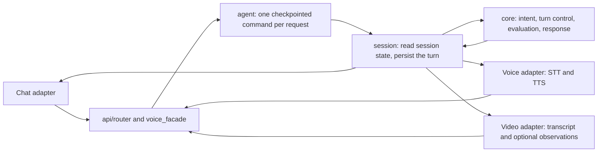

# Interview module architecture

The three interview modes share one assessment flow. Adapters normalize input and deliver output; they do not own question selection, turn decisions, or scoring.



The path of one candidate turn, as the code runs it (verified 2026-11-24):

```text
router / voice_facade
  → graph/runtime.run_interview_command("respond")
    → graph.InterviewCommandRunner.execute
                                             thread = (session, command, client_message_id); replay if completed
      → operations["respond"]              closure bound to the request's db session
        → session/chat_runtime.process_candidate_message
            build_session_state_from_db → CandidateTurnInput
            → agents.interviewer.graph.run_turn (turn graph and model decision)
              → core InterviewCoreEngine                  (guards, action handlers, output checks)
            persist messages, turn status, stage
```

Every modality submits the same ``core.contracts.interview.CandidateTurnInput``; there is
no second turn contract. The per-turn Interviewer Agent is separate from the durable
session-command workflow. ``agents/planner/PlannerAgent`` now owns prepare/freeze
orchestration and drafts the CV-grounded verification question. P1 planning,
CV project evidence, P2 selection, validation, and freeze modules now live in
``agents/planner/``. The deterministic entry gate is ``agents/planner/entry_gate.py``; job-level Question
Bank coverage/generation workflows live in ``question_bank/``. P2 no longer generates
Question Bank entries. A worker proposes review-only drafts from recorded gaps
after the session has closed and been scored.

For CV project evidence, P1 gives the Planner Agent the candidate's project
fields and job requirements through `submit_project_evidence`. The model may
propose claims and requirement links, but code accepts a claim only when its
quote is an exact substring of the matching CV project and its IDs are known.
Code scores and persists the validated evidence with the SQL plan. P2 reuses
that snapshot; no regex extractor or second model extraction pass remains.
Provider failure yields no structured project evidence and is traced.

For P1/P2, the Planner Agent may propose an ordering of code-derived competency
targets and select among code-filtered Question Bank candidates/feasible
subsets. The SQL-frozen Admin contract is included in both proposals. Code
validates each answer, enforces coverage/budget/uniqueness and freezes the
queue; invalid proposals use deterministic selection and are traced.
Planner orchestration is a compiled LangGraph. P1 uses the bounded
`rank_competency_targets` function tool; P2 uses a LangGraph tool loop with
read-only `search_question_bank` and validated
`submit_question_bank_selection` tools. The graph has no checkpoint because
the SQL plan and frozen queue are the durable state.

## Responsibilities

- `core/` owns behavior common to all modalities: turn state, evaluation rules, question response policy, and channel-neutral interviewer dialogue.
- `core/conversation/` owns the turn engine, response generation, and turn rules used for every modality.
- `core/contracts/` defines the shared interview input, output, stage, and action types.
- `core/session_policy/` defines the shared stage, timing, and demo-session rules.
- `core/dialogue/` owns shared dialogue policy, phrases, opening, language checks, playbook lessons, and speech-check diagnostics. It contains no STT, TTS, camera behavior, pronunciation, or audio recovery.
- `question_bank/` provides Question Bank coverage, generation, suggestions, insights and quality reporting; the deterministic entry gate is `agents/planner/entry_gate.py`.
- `graph/` runs the six session commands (`prepare`, `freeze`, `open`, `respond`, `finish`, `score`) on one compiled graph with a Postgres checkpoint per `(session, command, event)`. `InterviewCommandRunner` is workflow infrastructure, not an AI agent; operations arrive per call from `graph/runtime.py`.
- `agents/interviewer/` owns per-turn agent decision, menu, pacing, turn graph, decision record, and spoken-question drafting. `graph.py` is the graph entry point for one candidate turn; Core owns shared guards, action handlers, and output checks.
- `agents/planner/` owns P1 plan construction, CV project evidence, P2 selection/validation/freeze, prepare/freeze orchestration, and CV-grounded question drafting.
- `session/spoken_questions.py` persists validated spoken variants produced by the Interviewer Agent before the session opens.
- `question_bank/suggestions.py` queues Question Bank drafts for uncovered targets after close/score; drafts still require admin review.
- `graph/checkpoints.py` owns the Postgres checkpointer and the candidate-memory store lifecycle.
- Adapters normalise their input into `CandidateTurnInput` where they call the runtime. Voice accepts only a final transcript; partial STT is not an answer.
- Each modality package keeps `api/` transport only. The audio lifecycle lives in `realtime/`: the LiveKit worker, endpointing, interruption, `stt/`, `tts/`, `speech/` and `config/`. It owns transcription, transcript cleanup, answer buffering, audio turn taking, pronunciation, synthesis, and voice-only recovery phrases. Video observations remain telemetry unless an explicit assessment rule is added to Core.
- `session/` persists sessions and coordinates Core calls. `chat_runtime.py` is historically named; Voice and Video use this same runtime path.
- `admin/` reports settings, traces, and reviewed quality data. `progress/` owns candidate progress, calibration and skill summaries.
- `realtime/` owns the audio lifecycle: STT and TTS clients, the answer window, interruption, voice events and tuning. `adapters/voice/api/` keeps only transport.
- `memory/` owns LangMem retrieval and extraction; `blueprint/` owns the interview contract.

## Layout

```text
interviews/
|-- adapters/                  # transport only
|   |-- chat/api/              # router.py
|   |-- video_calls/api/       # router.py, signaling.py
|   `-- voice/api/             # router.py, Voice Lab endpoints
|-- realtime/                  # audio lifecycle (V2 spec §8)
|   |-- runtime.py             # LiveKit agent worker (the docker-compose entry point)
|   |-- endpointing.py         # when the candidate has finished speaking
|   |-- interruption.py        # barge-in
|   |-- events.py, health.py, voice_phrases.py
|   |-- stt/                   # provider.py, qwen.py, transcript.py, recognition.py
|   |-- tts/                   # provider.py, vieneu.py, cache.py, pronunciations_vi.py
|   |-- speech/                # language normalization and speech formatting
|   `-- config/                # voice tuning
|-- graph/                     # Main graph: the six commands
|   |-- graph.py               # command -> node dispatch, one compiled graph
|   |-- command_runner.py      # durable thread per (session, command, event)
|   |-- runtime.py             # run_interview_command: the entry point callers use
|   |-- ports.py, state.py
|   `-- checkpoints.py         # Postgres checkpointer + candidate-memory store
|-- agents/
|   |-- interviewer/           # graph.py (one-turn graph), thinker.py (the decider),
|   |                          # context.py, menu.py, pacing.py, tools.py, record.py,
|   |                          # state.py, spoken_questions.py
|   |-- planner/               # graph.py, prepare.py (P1), freeze.py (P2), selection.py,
|   |                          # evidence.py, entry_gate.py, planner.py, plan_structure.py
|   `-- evaluator/             # grading.py, report.py, rubric_grading.py, answer_outcome.py
|-- session/                   # business state and lifecycle
|   |-- chat_runtime.py        # shared persistence/runtime path for all three modalities
|   |-- text_runtime.py        # practice mode
|   |-- voice_facade.py, session_deadline.py, session_reaper.py, spoken_questions.py
|-- memory/                    # candidate_memory.py: store, seed, search tool, prompt
|                              # block, guard, langmem extractor
|                              # (rows in langmem's {kind, content} envelope)
|-- question_bank/             # coverage.py, generation.py, suggestions.py,
|                              # insights.py, quality.py
|-- blueprint/                 # service.py: interview types and versioned contracts
|-- progress/                  # candidate progress, calibration, skill summaries
|-- admin/                     # settings, traces, reviewed quality data, pipeline views
|-- core/
|   |-- conversation/          # turn_engine.py, response_generation.py, turn_rules.py
|   |-- contracts/             # interview.py
|   |-- session_policy/        # blueprint.py, demo_mode.py
|   |-- guardrails/            # input.py, output.py, common.py, llm_checks.py
|   `-- dialogue/              # policy.py, phrases.py, opening.py, playbook.py, speech_checks.py
|-- api/                       # router.py, blueprint_router.py, rate_limit.py
`-- facade.py                  # the public boundary for other modules
```

## Agent modes and flags (INTERVIEW_AGENT_DECISION_PLAN_V1)

| Env | Values | Effect |
|---|---|---|
| `INTERVIEW_AGENT_MODE` | `rule` (default) / `shadow` / `live` | `rule`: the rule ladder decides. `shadow`: the rule executes and the model choice is recorded. `live`: the model executes any valid action in the code-built menu; invalid, out-of-menu, or failed decisions fall back to the rule path. |
| `INTERVIEW_CANDIDATE_MEMORY` | `0` (default) / `read` / `readwrite` | `read`: seed from the gap notebook at `open`, load topics into the prompts, offer `search_candidate_memory` to the decider. `readwrite`: also extract after `score` with the `langmem` memory manager (extra `memory`); every model call it makes is an `ai_call_logs` row and the run is one Langfuse generation. |
| `INTERVIEW_UNIFIED_THINKER` | `0` (default) / `1` | Unified Thinker (V2 spec §6.2). The deciding call also returns the line the candidate hears, so an ordinary turn costs one provider call instead of two. Covers `acknowledge_and_probe`, `clarify_question`, `redirect_off_topic` and `answer_candidate_question`; `continue_warm_up` already worked this way. Each text passes that action's own output guard, and a rejected one falls back to generating the line, which costs the second call back but never the turn. `confirm_abort` and `close_interview` are deliberately left out: they happen at most once per session and usually arrive from an input guard, where there is no deciding call to carry the text. |

Every turn carries `metadata["decision"]` (menu, pacing, rule choice, model choice, agreement) and emits the `agent_decision` pipeline event; `scripts/eval/interviews/agent_shadow_report.py` reads them.

## V2 Phase 0 baseline (2026-11-26)

Measured before any restructuring, as INTERVIA_INTERVIEW_AGENT_V2_SPEC Phase 0
requires. These are facts about this HEAD, not targets.

| Question the spec asks | What the code does |
|---|---|
| Which mode runs? | Code default `rule`; the project `.env` sets `INTERVIEW_AGENT_MODE=live`. All three modes work. |
| LLM calls per turn | Input guard 0 · RULE 1 when the evaluator returns the probe in the same JSON, else 2 · LIVE 2 (decider + speech), 1 with `INTERVIEW_UNIFIED_THINKER=1` on the common actions (measured 1.2–1.25 live) · SHADOW 3. Counted by `tests/modules/interviews/agent/test_call_budget.py`. |
| Per-call latency | Already recorded: every call writes an `ai_call_logs` row with `duration_ms`, `purpose` and `model`. Percentiles come from that table. |
| Qwen STT | `STTCapabilities(streaming=True, interim_results=True)`; 1.0 s chunks, 0.8 s endpoint silence. Partial transcripts exist. |
| VieNeu TTS | `TTSCapabilities(streaming=False)`. No text-streaming API; audio arrives as an SSE byte stream per sentence, so progressive playback works and AC-12 needs no new API. |
| Endpointing | Fixed `COMMIT_SILENCE_SECONDS=1.8` / `SHORT_COMMIT_SILENCE_SECONDS=2.2` by default; `VOICE_ADAPTIVE_ENDPOINTING=1` switches to the three-band adaptive wait of §8 (`realtime/endpointing.py`), not yet calibrated on real Qwen finalization. **Profiled (run 4):** the wait was one of three silence timers in series; see "Critical path" below. |
| Main graph | Already exists: `graph/graph.py` dispatches the six commands on one compiled graph with a Postgres checkpoint. |
| Video path | `adapters/video_calls/api/router.py::chat_voice_on_call` bypasses Core entirely (a bare `generate_text`). It and the chat/voice `chat` endpoints sit behind `legacy_interview_api_enabled`, **false** by default. |
| Luna / Talker | Not a separate service: an OpenAI model id (`gpt-5.6-luna`). `src/modules/ai/facade.py` now takes a per-call `model=`, so the Talker uses the existing provider (spec §1.1). Settings: `interview_talker_model` (empty = use `llm_model`) and `interview_talker_enabled` (**false**). |
| Broker for background work | RabbitMQ + Celery already configured; no new infrastructure is needed for §9. |

## V2 migration status (2026-11-26)

Three columns, as the V2 correction brief §10 asks: what is built, what the
target is, and what is left. **The refactoring is not finished.** Nothing below
is marked done without a test or a measurement behind it.

Four words are used deliberately: **implemented** = code and unit tests exist;
**experimental** = implemented but off by default and not accepted for
production; **verified** = a gate is green (full suite, dual-run, snapshot) or a
live measurement exists; **blocked** = something outside this branch must
happen first. Hybrid and Luna are experimental and stay disabled; Unified
Thinker + Anticipation is the accepted direction (benchmark decision, 2026-11-26).

### Built and verified

| Area | State | Evidence |
|---|---|---|
| Core boundary (brief §2) | Core is framework-independent: no AI provider, LangGraph, LiveKit, database or LangMem. Inference sits behind `TurnInference`; `agents/interviewer/engine.py` composes the halves. | `test_import_boundaries.py` |
| Unified Thinker (§6.2) | One inference carries evaluation, decision and the spoken line for `acknowledge_and_probe`, `clarify_question`, `redirect_off_topic`, `answer_candidate_question`. Each text passes that action's own guard; a rejected one falls back. | `test_call_budget.py`, measured below |
| Adaptive endpointing (§8) | Wait follows transcript completeness, stability and ASR confidence across the spec's three bands. | `test_adaptive_endpointing.py` |
| Anticipation Engine (§7, brief §5) | Owns speculation; the runtime holds no preview fields. `take()` is synchronous and cancels speculation still in flight; results are consumed once; unchanged interims cost nothing. **The seven-field binding is the server's:** one builder (`session/preview_authority.py`) is used at issuance (sealed in the token), at redemption (rebuilt from the database, compared strictly) **and once more at the claim, under the session row lock** — the sealed key travels with the accepted preview into `process_candidate_message`, which re-reads the turns under `FOR UPDATE`, refuses the answer if the ASKED turn moved, and drops the preview (canonical inference runs) if any of its fields moved between redemption and the claim. The worker validates only session + transcript and reports the rest as unchecked. | `test_anticipation.py`, `test_preview_key_authority.py`, `test_chat_runtime.py` (claim revalidation), `test_core_in_flight_flow.py` |
| Execution paths (§6.1, brief §6) | `router.py` picks Fast / Unified / Hybrid inside LIVE from values the turn already holds — never a call. RULE/SHADOW are untouched rollout modes. Fast executes a server-validated preview with 0 new calls. | `test_execution_paths.py` |
| Hybrid Parallel (§6.4, brief §7) | `talker.py` (Luna via the existing provider's `model=`), `arbiter.py` (deterministic, no third call). Thinker and Talker run concurrently; the guarded early acknowledgment reaches the worker before fan-in over an opt-in NDJSON stream of the internal message endpoint (`response.early` → `response.final`); Luna is not waited for once the Thinker answers. **Off by default** (`interview_talker_enabled`). | `test_execution_paths.py`, `test_runtime_message_stream.py`, `test_core_in_flight_flow.py` |
| Talker model reachable (§7) | `gpt-5.6-luna` resolves through the existing OpenAI provider. | live probe, 2026-11-26 |
| Session runtime in phases (brief §8) | `process_candidate_message` is an orchestrator over typed phases: `_load_turn_context` → `_claim_candidate_message` (row lock, idempotency, Phase 1 write, commit) → `_prepare_inference` → `_run_authoritative_inference` (the only provider call, outside any lock) → re-lock → exactly one transition (`_commit_abort` / `_commit_clarify` / `_commit_probe` / `_commit_closing_reply` / `_settle_current_turn` + `_ask_next_question` / `_close_session`) → commit → `_turn_response`. SQL text, lock placement, commit order and event ordering are unchanged. | `test_chat_runtime.py`, `test_chat_full_flow_integration.py`, dual-run, snapshot 35/35 |
| Evaluator + background memory (§9) | The report is persisted under its `interview_evaluation_jobs` lease and committed before anything else runs. Extraction is a durable job on the existing Celery/RabbitMQ worker and its default queue (`memory/extraction_job.py`, `workers/tasks/interview_memory.py`). **Job state lives in PostgreSQL** (`interview_sessions.metadata->'memory_extraction'`: QUEUED / PROCESSING / DONE / FAILED with `permanent`). `score` writes QUEUED and commits *before* `send_task`; the worker takes a transaction-scoped advisory lock held for the whole extraction and **re-reads the state under the lock** (check-then-lock race closed); failures are classified — disabled = skip, missing dependency or a refused provider request = permanent, connection/provider outage = transient with bounded exponential backoff (`rabbitmq_max_attempts` total attempts); a reconciler in the API lifespan re-dispatches evaluations of the last 6 h whose job is neither DONE nor permanently failed, at most 5 times. At-least-once by design, stated in the module. **Verified on a real RabbitMQ + worker** (2026-11-26): broker → worker → DB → store round trip, durable FAILED on a refused provider key (401), duplicate delivery skipped, reconciliation of a persisted-but-undispatched evaluation, and one real extraction end to end (see "Remaining migration work"). The failure written after an extraction's rollback is guarded against a *permanent* failure written meanwhile as well as against DONE (a transient FAILED over the reconciler's `dispatch_exhausted` would have reopened the job). | `test_memory_extraction_job.py` (53) |
| §13 instrumentation | The agent marks speech end, submit and Core answered, and reports `voice_reply_started` per utterance kind with the elapsed times; `voice_answer_submitted` carries `since_speech_end_ms`; TTS metrics carry the kind. `scripts/eval/interviews/voice/livekit_turn_metrics.py` derives TTFA, TTMR, Qwen finalization, endpointing wait, VieNeu first byte, calls/turn, wasted speculation, hit rate, early-ack availability and a false-cut proxy with P50/P95/P99 from stored events — no provider call. **Run on a real room** (run 3, four sessions). Since run 4 the agent also reports the endpointing chain per submit (`voice_endpointing`: VAD end → final → LiveKit turn end → submit, with the anchor and the wait it scheduled), fillers cut by the reply and the prefetch round trip, and the report attributes pre-submit events (STT finish, nudge audio, prefetch) to the answer they preceded — run 3's "TTFA" rows had read the *next* answer's nudge. | `test_livekit_turn_metrics.py` |

### Measured, not assumed

Two live runs, whole LIVE turns through the real turn graph, Thinker on
gpt-4o-mini, Talker on gpt-5.6-luna. Every provider call is counted at
`record_ai_call`, so speculation, the Talker and fallback speech are included.

**Run 1** — `unified_thinker_benchmark.py`, n=20/mode (2026-11-26):

| | calls/turn | p50 | p95 | carried own line |
|---|---|---|---|---|
| baseline | 2.00 | 3353.9 ms | 5547.9 ms | — |
| unified | 1.25 | 3352.4 ms | 4285.1 ms | 15/20 |

**Run 2** — `execution_paths_benchmark.py --turns 10`, four configurations:

| config | calls/turn (incl. spec) | spec calls | p50 | p95 | spec p50 | carried | guard-rejected | early ack avail. p50 | tokens in / out |
|---|---|---|---|---|---|---|---|---|---|
| baseline | 2.0 | 0 | 4303.8 ms | 8570.7 ms | — | 0 | 0 | — | 25 231 / 1 399 |
| unified | 1.2 | 0 | 3475.2 ms | 4678.0 ms | — | 8/10 | 2 | — | 25 639 / 1 602 |
| anticipation | 1.1 | 10 | **5.4 ms** | 1787.9 ms | ~3.4 s | 9/10 | 1 | — | see caveat |
| hybrid | **2.2** | 0 | 3337.2 ms | 4843.9 ms | — | 7/10 | 3 | 1989.1 ms (9/10) | 32 754 / 2 384 |
| hybrid_plain (Unified off) | **2.9** | 0 | **4419.7 ms** | 6757.6 ms | — | 1/10 | 0 | 1869.2 ms (6/10) | 31 531 / 2 204 |

How to read it, honestly:

- **Unified.** The two runs disagree on the median (flat in run 1, −19% in run
  2; provider latency swung a lot — baseline p95 was 5.5 s then 8.6 s) and
  agree on what matters structurally: call count −37…40% and tail −23…45%. Do
  not quote a p50 figure as established.
- **Anticipation's 5.4 ms is a ceiling, not an expectation.** The harness
  speculates on the exact final text, so its hit rate is 100% by construction,
  and the speculation itself took ~3.4 s. In a room that call overlaps the
  candidate's speech; if they stop talking before it lands, the turn falls back
  to Unified. Real hit rate is unknown until measured with real partial
  transcripts. Run 2's token column for this row excluded the speculative
  calls; the harness has since been fixed to charge them.
- **Hybrid, as configured, is net-negative.** It made *more* calls than
  baseline (2.2 vs 2.0), used +30% input / +70% output tokens, and did not
  move TTMR (p50 3337 ≈ unified 3475). Luna's prediction was **never reused**:
  with Unified on the Thinker always carries its own line, so the Arbiter
  correctly kept it (6× `thinker_has_text`, 3× `target_mismatch`, 1×
  cancelled at fan-in). The only thing Hybrid bought is a guarded acknowledgment
  available ~2.0 s in on 9/10 turns — and the correction brief is explicit that
  early acknowledgment alone is not a meaningful-response improvement.
- **`hybrid_plain` (Unified off) is worse still, and it settles the question.**
  This is the one configuration in which Luna's predicted line could replace
  the speech call, so it was run under a hard cap of 30 calls (29 sent).
  Result: the most calls of any configuration (2.9/turn: Thinker + Talker +
  the speech call Luna failed to replace), the slowest authoritative response
  (p50 4420 ms, p95 6758 ms), and a Luna reuse rate of **1 in 6** where a Talker
  output existed. Decomposed: action mismatch **0%**, target mismatch **83%**,
  guard-rejected 0% — Luna and the Thinker agree on *what to do* and disagree
  on *which missing point to probe*, which §6.4 rightly refuses to paper over.
  Four of ten turns had no Talker output at all because the Thinker finished
  first and Luna was cancelled at fan-in. Per-role p50: Thinker 2378 ms,
  Talker 2083 ms — Luna is not meaningfully faster. Tokens: gpt-5.6-luna 10
  calls 7 218 / 885; gpt-4o-mini 19 calls 24 313 / 1 319 (10 Thinker + 9
  speech fallbacks). Early ack ~1.9 s on 6/10, as before. No guardrail was
  changed to improve any of this.
- **Recommendation: Hybrid stays disabled; Unified + Anticipation is the
  default architecture.** Unified is the only configuration that lowers both
  call count and tail latency without a cost penalty; Anticipation adds the
  near-zero post-speech cost *when its preview hits*, which is the one number
  still unmeasured (it needs real partial transcripts). Hybrid's early
  acknowledgment is real but buys no meaningful-response latency and costs a
  guaranteed extra Luna call per turn; it should be revisited only if TTFA
  becomes a product goal in its own right.
- **Guard rejections: 20–30%, all `hints_answer`.** The criteria-terms prompt
  steer removed the `evaluative` rejections but not these. The rejected text is
  now traced so the next run can show whether the guard is refusing a real
  leak or a redirect that merely restates the question's own topic. The guard
  is untouched.
- **Not measured in runs 1–2:** TTFA and TTMR (they need a LiveKit room and
  a speaking candidate — run 3 below); response-quality parity (shadow
  report; see "Quality parity" below). A Luna call cancelled at fan-in may
  still be billed; the harness cannot see that.

Stub runs (`--stub`, zero spend) confirm every configuration routes as
designed; runs 1–3 are live measurements, run 4 is a profile of run 3's
stored events plus two provider-free measurements.

**Run 3 — LiveKit pilot** (2026-11-26, `livekit_pilot.py`: a synthetic candidate
playing the same eight VieNeu-synthesized Vietnamese answers into a real room;
real Qwen STT `Qwen/Qwen3-ASR-0.6B`, real Thinker `gpt-4o-mini`, real VieNeu
`vieneu-v3-turbo`; flags read back from the running backend and voice-agent
containers before each session; Hybrid off; one session of 8 answers per
configuration — **a pilot, not a P95**). Sessions: baseline
`7583d3b4-ee2b-4adf-89c9-48fc5bccd651`, unified `917d7cb4-5a8b-41ac-9ba3-75023fb3579b`,
anticipation `07bfbb98-7d15-4814-b243-e10ea95d7311`, endpointing `0aadd15b-9057-42d2-95f5-ddf59dbadaf6`.

| | baseline | unified | +anticipation | +adaptive endpointing |
|---|---|---|---|---|
| TTFA p50 (speech end → first audio, server) | 3468 ms | 3476 ms | 3575 ms | 3587 ms |
| TTMR p50 (→ official reply) | 7720 ms | 7269 ms | 6743 ms | 7611 ms |
| TTMR max of 8 | 13247 ms | 8951 ms | 12850 ms | 10209 ms |
| client TTFA p50 (end of candidate audio → first audible agent audio) | 5589 ms | 5451 ms | 5451 ms | 5561 ms |
| speech end → submit p50 (endpointing wait) | 2857 ms | 2843 ms | 2857 ms | 3006 ms |
| Qwen finalization p50 (LiveKit's `transcription_delay`, 3 of 8 turns; run 4 reads Qwen's own diagnostic on all 8: 1702 / 1685 / 1715 / 1723 ms) | 1532 ms | 1657 ms | 1557 ms | 1644 ms |
| Core p50 | 3699 ms | 4143 ms | 3010 ms | 3894 ms |
| reply playback after Core p50 | 1131 ms | 476 ms | 1117 ms | 1085 ms |
| VieNeu first byte p50, question / filler | 453 / 1117 ms | 457 / 1109 ms | 453 / 1117 ms | 454 / 1124 ms |
| provider calls, session-attributed (incl. 6 planner) | 16 | 14 | 15 | 14 |
| provider calls **unattributed** (preview endpoint) | 0 | 0 | 48 | 44 |
| anticipation: started / reused / discarded | — | — | 24 / 0 / 5 stale | 22 / 0 / 3 stale |
| false-cut proxy (speech after submit) | 0/8 | 0/8 | 0/8 | 0/8 |
| core failures | 0 | 0 | 0 | 0 |

What the pilot says, and what it cannot:

- **TTFA is the pause nudge, and run 3's TTFA row was mis-attributed.** In
  every configuration the first audio after an answer is the mid-answer nudge
  ("mình đang nghe…"), which fires 1.25 s after a fragment while the commit
  fires at 1.8 s, then pays ~1.1 s of VieNeu first byte. Run 3's report
  assigned that audio to the *previous* turn (it plays before the submit), so
  its "TTFA p50 ≈ 3.5 s" mixed turns; re-read with the corrected attribution
  (run 4) it is 2565 / 2323 ms (baseline / unified), still the nudge on 8 of
  8 turns. None of the three features touches that path.
- **Unified** made one call per answer instead of 1.25 and lost nothing
  visible: TTMR p50 7.3 s vs 7.7 s, worst turn 9.0 s vs 13.2 s — eight turns,
  so treat as "not worse", not as a gain.
- **Anticipation reused nothing.** 24 speculative previews, each two provider
  calls (evaluation + unified decision), **four times the session's spend**,
  every finished preview discarded as `stale`: a continuous speaker's final
  transcript never equals the partial the preview ran on. The per-session
  budget check did not see these calls because the preview endpoint logged
  them with no session id (fixed in this commit: they now carry the session
  and a `speculative.` purpose prefix).
- **Adaptive endpointing changed nothing measurable** (speech end → submit
  3.0 s vs 2.9 s). Run 4 established why: the window's wait is the *last* of
  three serial timers, so shortening it by band cannot remove the 1.07 s the
  recognizer and LiveKit spend first; and on these answers every band
  resolved to the 2.0 s "hesitant" wait (turn end → submit was 2000 ms on all
  8 turns), because the synthetic speaker's fragments end without a closing
  particle or punctuation.
- Not measured: true false cuts (the proxy saw none; a human has to listen),
  quality parity (`agent_shadow_report.py`, separate), and the candidate's
  real playback leg beyond the synthetic client.

**Recommendation (production flags), from these measurements:**
`INTERVIEW_UNIFIED_THINKER=1` is the candidate default once the shadow
quality report is clean (fewer calls, latency not worse, two live runs plus
the pilot agree). `VOICE_LLM_SPECULATIVE_PREVIEW=0` (anticipation off: 0 hits,
4× spend). `VOICE_ADAPTIVE_ENDPOINTING=0` (no measured effect).
`INTERVIEW_TALKER_ENABLED=false` (unchanged). The latency floor the pilot
shows — ~2.9 s of endpointing wait, ~1.5 s of Qwen finalization inside it,
3–4 s of Core — is where the next work is, not in the three flags. Run 4
below is that work.

**Run 4 — critical-path profile** (2026-11-26; the stored events and call logs
of run 3's four sessions, re-read per turn; plus two measurements that cost
no provider call: VieNeu first byte against text length and idle time, and
the pilot answers' pause structure). Nothing here is a new live session.

*Speech end → submit, per turn (p50 of 8, each configuration within ±30 ms):*

| leg | p50 | what it is |
|---|---|---|
| last voiced PCM → VAD end of speech | 1 430 ms | Silero kept "speaking" ~1 s longer than Qwen's RMS threshold on the synthetic audio; a human tail is expected nearer the 0.45 s `min_silence`. **Unverified for a person.** |
| VAD end → Qwen final transcript | 276 ms | Qwen's 0.8 s of audio silence, up to 0.8 s of chunk backlog (each 1 s chunk takes 430–490 ms to process, serially), the last partial chunk (316 ms) and `/api/finish` (430 ms): 1 702 ms from the last voiced PCM, overlapping the VAD leg. |
| final → LiveKit turn end | 804 ms | LiveKit's fixed `min_endpointing_delay=0.8`, counted *after* the final transcript. A second silence timer. |
| turn end → submit | 1 800 ms (2 000 ms with adaptive endpointing) | The answer window's own wait. A third. |
| **VAD end → submit** | **2 857 ms** | = 276 + 804 + 1 800, three timers in series. With a human speaker (final ~1.25 s after VAD end) the same chain is ~3.9 s. |

*Core, per turn:* the provider call is 97–98 % of it. `core_ms − Σ call_ms` =
67–142 ms (agent → API hop, claim, prepare, persist, commit); the turn
graph outside the call = 6–18 ms; memory retrieval is one Postgres query
cached 60 s per user (no embedding call). Provider latency fits
`1 885 ms + 0.063 ms × input tokens + 13.0 ms × output tokens` (n = 35
calls, gpt-4o-mini via the Responses API): 2 500 input tokens cost ~160 ms,
150 output tokens ~2 000 ms. The decider's output — rationale, evidence
refs, the `covered`/`missing` evaluation lists, the spoken line — is the
lever; shrinking it is a prompt/contract change and belongs after the
quality-parity report, not in this run.

*Voice output:* VieNeu first byte is **447–465 ms** for 17 to 218 characters on
a warm connection, **1.07–1.21 s** after ≥ 6 s idle or on a fresh client (4 s
idle still warm), and a `GET /health` costs the same cold start and warms it.
In the pilot the nudge lines were synthesized each time (1.1 s, not fixed
lines), and once a nudge was served from the in-memory cache the question
after a 25-second answer paid the cold start instead (baseline question
first byte 1 124 ms vs 466 ms in unified, where an uncached nudge had just
warmed the connection). A nudge was still playing when Core answered on 3 of
22 nudged turns, holding the question back by up to 477 ms; p50 "reply
playback after Core" 1 131 ms (baseline) is the cold first byte, not the queue.

*Budget:* the preview endpoint's calls were invisible to any counter; no
cap existed at dispatch; the SDK retried transport errors once on its own,
uncounted.

*What changed from the profile (this commit), each measured or testable
without a provider:*

- **Hard call budget at dispatch** (`src/modules/ai/budget.py`, charged in
  `facade._responses_create` before every attempt — the first, the retry
  after a refused option, the one transport retry that replaces the SDK's;
  `max_retries=0`). A turn runs under `INTERVIEW_TURN_CALL_BUDGET` (6), a
  preview under `INTERVIEW_PREVIEW_CALL_BUDGET` (2), the prefetch under 0,
  all against `INTERVIEW_SESSION_CALL_BUDGET` (120) per process. A refused
  call fails like a provider error and is an `ai_call_logs` row with
  `error_type=CallBudgetExceeded`. `test_call_budget_dispatch.py`.
- **LiveKit's 0.8 s post-final delay removed for Qwen** (`min_delay=0.0`,
  like AssemblyAI; `max_delay` ≥ 3 s so a Qwen final arriving 1.7 s after
  speech end is still waited for). Expected: −0.8 s on every turn, no change
  to the candidate's silence allowance beyond that duplicate.
- **One explicit anchor for the window** (`VOICE_ANSWER_COMMIT_ANCHOR`):
  `transcript` (default, today's clock) or `speech_end` (the 1.8 / 2.2 s
  count from VAD end of speech; the recognizer's latency is not waited for
  again). The constants did not move. **The default stays `transcript`:**
  the pilot material has intra-answer pauses of 1.3–2.6 s (measured on the
  eight WAVs) that a 1.8 s window counted from a prompt VAD end would cut,
  and the spec's own §8 bands top out at 2.2 s. The human-speaker benchmark
  with labelled false cuts decides it (`livekit_human_benchmark.py`, arm
  `unified_speech_end`).
- **Nudges are fixed lines** (cached on disk after the first synthesis),
  **the TTS connection is kept warm** (`VieNeuTTS.warm`: at speech start,
  at submit and every 3 s while Core thinks — measured warm at 4 s idle,
  cold at 6 s), and **the reply cuts a nudge or filler still playing**
  (`_interrupt_filler`, reported as `voice_filler_interrupted`). Expected:
  question first byte 1.1 s → 0.45 s on every turn, and no queueing behind
  the nudge. `VOICE_ANSWER_PAUSE_NUDGE_ENABLED=0` is the filler-off arm of
  the audit.
- **Deterministic prefetch, separate from speculation**
  (`POST /livekit/runtime/prefetch`, called by the agent when an answer
  starts): candidate memory and the interviewer playbook, under a zero call
  budget. The profile says the whole non-provider part of a turn is ~80 ms,
  so this is worth at most that; it exists so the deterministic part no
  longer rides on a speculative inference that costs two calls. The turn
  still reads its authoritative context under the claim's row lock.
- **Per-turn phase timings** (`turn_phases` event: load, claim, prepare,
  inference, persist, commit) and the endpointing chain per submit
  (`voice_endpointing`), so the next pilot reads the profile directly.

*Expected after these changes, to be measured, not claimed:* VAD end → submit
2.86 s → ~2.05 s (`transcript` anchor) or ~1.8 s (`speech_end`); reply
playback after Core ~1.1 s → ~0.5 s; TTMR p50 ~7.3 s → ~5.7 s (unified).
A validation session costs ~16 provider calls per configuration; it was not
run in this commit (no authorization for paid calls was given for it).

**Quality parity (shadow report), what exists:** `agent_shadow_report.py` now
reads the stored decision records (it dropped every LIVE turn before — the
event stores the full record, the report expected its summary) and reports
LIVE turns on their own. Over the last 60 days of this database: 53 live
turns in 10 sessions, executed by the model 100 %, 0 menu violations, 0
decide errors, graph p50 3 680 ms, actions `continue_warm_up` 47 ·
`repeat_question` 5 · `acknowledge_and_probe` 1. **That distribution is the
finding:** the pilot's synthetic answers never left the warm-up, so the
Unified Thinker's text-carrying actions (probe, clarify, redirect, answer)
were exercised once in four sessions; "carried its own line" is 0/34 because
`continue_warm_up` is natively one call in every mode. Parity between the
model's decisions and the rule ladder needs a SHADOW period (3 calls per
turn) or the human benchmark's sessions; neither was authorized here.


### Context-aware streaming backchanneling (brief 2026-11-26)

The Talker is repurposed, not redesigned: the same Luna model through the
same facade, the same acknowledgement guard, the same playback queue and the
same cut-on-reply rule, doing a different job. The prediction path
(`predict_by_talker`, Hybrid) stays in the code and stays off.

**Responsibility split, as built.** The Thinker (`gpt-4o-mini`) keeps
evaluation, decision, probe target, the authoritative line and every state
transition — nothing in it changed. The Talker
(`talker.backchannel_by_talker`) sees a compact rolling context
(`BackchannelContext`: the current question, the interviewer's last four
lines, the stable transcript so far, the phase `listening | processing`,
whether the candidate is speaking, seconds since it last spoke, answer
seconds, fragments, the backchannels already said this turn) and nothing
else — no rubric, no CV or JD text, no action menu, no probe target, no
evaluation. It answers on one line with a *decision*, `kind: silence |
minimal | reflective | contextual | processing`, then at most one short
line. There is no template and no selection: silence is a kind the model
chooses, and the prompt names kinds, never utterances. Every unit passes
`arbiter.arbitrate_backchannel` — the acknowledgement guard (no verdict,
praise, hint, question, parroting, rubric or system leak, house style) plus
a length cap and a no-repeat check — before it leaves the API.

**Streaming, inspected (what each hop supports, 2026-11-26):**

| hop | input | output | used |
|---|---|---|---|
| LiveKit audio in | frames, streamed | — | as before |
| Qwen STT | 1 s chunks (HTTP, serial) | interim transcript per chunk, final after 0.8 s silence | the *stable* segments only: a finished fragment (the candidate paused) and the submit |
| Talker context | **no persistent incremental input**: the Responses API keeps no state here (`store` false, no `previous_response_id`); each call carries the whole compact context | token deltas (`stream=True`, `response.output_text.delta`; `facade.generate_text_stream`) | bounded incremental inference over stable segments: at most one in flight per session, ≤ 3 calls per turn, ≥ 4 s between listening-phase calls, never per interim |
| Thinker | — | tool-call argument deltas exist in the SDK (`response.function_call_arguments.delta`) | **not streamed**: the action must be in the menu and the line must pass its guard as a whole before anything is spoken; streaming a strict-JSON tool call would start TTS on text that may yet be rejected. Reported as unsupported-by-design, not as a gap in the provider. |
| VieNeu TTS | one complete text per request (no incremental text) | PCM over SSE | a validated unit is one request; playback starts on its first SSE chunk (~450 ms warm) |
| LiveKit playback | `say(text)` per unit | streamed frames | one speech handle per unit, interruptible, outside the chat context, cut by the authoritative reply |

Luna's acceptance of `stream=True` is a code-level fact of the SDK, not yet
a live-verified one: the probe is one paid call and was not authorized.

**Where it runs.** The voice agent asks at two safe moments only: when a
Qwen fragment ends (the candidate paused — `on_user_turn_completed`, phase
`listening`) and at the submit (phase `processing`, beside the canonical
POST, never awaited by it). `realtime/backchannel.py` holds the bounds and
the staleness rules: one inference in flight, the turn cap, the minimum gap,
a unit that arrives while the candidate is talking waits ≤ 1.5 s for a pause
and is otherwise dropped, anything after the authoritative reply or after a
new answer is dropped, and the candidate starting to talk over a playing
backchannel is counted (`voice_backchannel_overlap`). The API endpoint
`POST /livekit/runtime/backchannel` streams NDJSON units under a one-call
budget scope (and the session cap). When the feature is on, the template
nudge and the processing filler are not used. Barge-in handling, the echo
filter and `add_to_chat_ctx=False` apply to backchannels as to any filler;
the same VieNeu voice speaks both roles.

**Cost bounds.** `INTERVIEW_BACKCHANNEL_CALLS_PER_TURN` (3) and
`INTERVIEW_BACKCHANNEL_MIN_GAP_SECONDS` (4) are spend bounds, not pacing
rules — the model is told how long ago it last spoke and chooses silence
itself. Each call is ≤ 80 output tokens on a ~400-token input.

**Benchmark, prepared and not run.** `livekit_pilot.py --config backchannel`
and the human-benchmark arm `unified_backchannel` (against
`unified_no_nudge`, the same configuration with no backchannel at all);
`livekit_turn_metrics.py` reports Talker time to first token, generation
latency, units spoken / discarded (stale rate), candidate overlaps,
processing acks, Talker calls and tokens, and treats a backchannel as first
audio for TTFA — **which is why TTFA will not be quoted as a latency gain**:
a backchannel playing earlier moves TTFA, not TTMR. The listener's labels
(`backchannel_relevance`, `backchannel_naturalness`,
`backchannel_interrupted_person`, 1–5 and yes/no per turn) are the only
measure of relevance and naturalness; the record also carries the
Evaluator's report so answer quality can be compared across arms. Not run:
the synthetic session (~16 Thinker + ≤ 24 Talker calls) and the human
sessions need paid calls and were not authorized.

**Limitations, stated.** No persistent incremental input to the Talker (each
call re-sends the context; cost grows with the answer); the Thinker's output
is not streamed (by design, see above); Qwen's interims are serial 1 s
chunks, so the "stable segment" granularity is a fragment, not a word; a
backchannel can still start up to ~0.5 s after a pause began (Talker TTFT +
TTS first byte) and will be dropped if the candidate resumes in the meantime
— its real hit rate is unmeasured; relevance and naturalness are human
judgements and have none yet.

### Run 5 — streaming backchannel validation (2026-11-26; 46 paid calls of the 81 authorized)

**Luna streaming probe (1 call, the real backchannel prompt, 666 input
tokens):** real incremental delivery — 26 deltas of 1–11 characters — but
**time to first token 4 080 ms**, the whole 30-token line inside the next
343 ms (inter-delta gaps 0/89/122/128 ms), total 4 502 ms; usage reported
in `response.completed` (666 / 30). The line was 18 words against a prompt
asking for 12, so the guard's 14-word cap rejected it: the prompt now asks
for 10 and the cap is 16. In the benchmark below, 16 Talker calls had TTFT
734–1 174 ms (p50 822) and total 846–1 291 ms — the probe's 4 s was the
first call on a cold model, not the rate. **Conclusion: streaming is real
but the stream is short; what the candidate waits for is the first token.**

**Audit of the first implementation (localized changes, all tested):**
(1) the Talker is now also asked on a *stable* partial — Qwen re-emitting an
unchanged interim — not only at fragment ends and the submit; (2) generation
is separate from playback: a line prepared during speech waits up to 6 s for
the next natural pause and is then re-checked against the transcript as it
is *now* (dropped as `context_moved` after > 12 new words); (3) the prompt
no longer forces silence while `speaking=true` — it says the line will play
at the next pause, so follow the completed thought; (4) exactly one validated
unit per inference, the stream closed the moment it is known; (5) a unit is
emitted at its terminator, not at the following whitespace or the end of
the stream; (6) explicit closure on every exit path — the facade closes the
SDK stream and its inner generator, the Talker closes the facade's, the
coordinator closes the API's — and an early close is an `ai_call_logs` row
with `error_type=cancelled` (usage unknown: the provider reports none for a
stream it did not finish); (7) a cancelled inference is awaited before the
next one starts, so two Talker streams never overlap for one session;
(8) see (2). Found by the benchmark and fixed after it: cancelled rows were
lost to the table's `status IN (ok, error)` constraint (9 of session B's 16
Talker calls were invisible), and a cancelled inference left no event.

**Qwen adapter profile** (real server, real-time paced, two pilot answers,
no LLM): the server decodes on its own 1 s window, so client chunk size does
not add partials — 22 and 11 interims for every size; 18 of 21 interims had
their tail revised later (stability is low: only a *repeated* interim is
safe to act on, which is what the stable-partial trigger uses).

| chunk | request p50 | backlog max | pcm end → final |
|---|---|---|---|
| 1 000 ms | 440–742 ms | 660–680 ms | 1 956–2 276 ms |
| 500 ms | 313–331 ms | 560–620 ms | 1 905–1 941 ms |
| 320 ms | 315–321 ms | 740–820 ms | 1 885–2 236 ms |
| 250 ms | 317–318 ms | 820–880 ms | 1 909–2 921 ms |

500 ms is the only size that helps (slightly: −50 ms to the final, lower
backlog); 320 and 250 ms add requests faster than the server drains them.
Not changed in configuration: the server's `--chunk-size-sec` must match.

**Controlled benchmark** — two matched synthetic sessions, same eight
answers, Unified Thinker, nudge off, Hybrid off, hard caps at dispatch
(turn 6, session 40, Talker 2 per turn): A = no backchannel
(`183fa339-7d21-4781-985c-5895e636d7f4`), B = streaming Talker
(`4c698ae3-e686-4f0e-b4f3-813a63268d32`). p50 of 8 unless stated.

| | A (no backchannel) | B (backchannel) |
|---|---|---|
| client TTFA (end of answer audio → first audible agent audio) | 9 075 ms | 5 961 ms |
| client TTMR (→ first audio after the agent reports the reply) | 9 075 ms | 9 002 ms |
| server TTFA / TTMR | 5 905 / 5 905 ms | 3 746 / 6 454 ms (p95 7 577 vs 8 368) |
| speech end → submit | 2 076 ms | 2 058 ms |
| Core | 3 421 ms | 3 755 ms |
| reply playback after Core | 459 ms | 640 ms |
| Talker time to first token / to unit | — | 822 / 936 ms (n=9 with events; 16 calls) |
| Talker decisions | — | 16 inferences: 7 silence, 7 units synthesized, 6 audible, 1 cut before playing, 1 processing ack |
| first audible backchannel after speech end | — | 2 070–3 971 ms (5 measured) |
| candidate talked over a backchannel | — | 0 (synthetic speaker) |
| fillers/backchannels cut by the reply | 0 | 5 of 8 turns |
| provider calls (attributed) | 14 | 22 logged + 9 early-closed Talker calls lost to the constraint = 31 |
| tokens in / out | 28 195 / 1 882 | 36 363 / 2 255 logged (+ ~9 × 1 000 in, unknown out) |
| late speech after submit | 0/8 | 0/8 |
| Evaluator | not run: the sessions never left the warm-up ("chưa có lượt trả lời chuyên môn") | same |

What it says: **TTMR did not move** (client 9 075 → 9 002 ms, server
5 905 → 6 454 ms — provider variance, n=8), as it must not: backchannels are
not a latency improvement and are not claimed as one. **TTFA moved by
~3.1 s** because a backchannel played first on 5 of 8 turns — that is
earlier acknowledgment, not an earlier answer. Backchannel first byte paid
VieNeu's cold connection (1 105–1 134 ms on 6 of 7; the keep-alive runs only
at speech start and during Core); the reply's TTS was delayed ~180 ms by
cutting the backchannel. Cost: +9 Talker calls per 8 answers at this cap,
each ~900 input tokens (the context is re-sent), ~1.9 s of Talker wall time
per turn off the critical path. Relevance and naturalness: **not rated** —
the spoken text is not stored (events carry no speech) and a synthetic
session cannot be human-rated; the 18-word probe line was on topic. Also
under-reported: only 2 `voice_backchannel_spoken` events for 7 syntheses;
the agent now logs each spoken/discarded/cancelled unit so the next run can
say why. The client-server TTMR gap (~3.1 s) is the synthetic speaker's
VAD tail (~1.4 s, run 4) plus transport and jitter buffering.

**Remaining bottlenecks, in order:** the Thinker's provider call (3.4–3.8 s
Core, 97 % of it); the ~2.05 s silence window (now one clock; `speech_end`
anchor untested on a person); the Talker's ~0.8 s TTFT plus TTS first byte
when the connection is cold; the Qwen 1 s decode window (~1.7 s to final).

### Immediate speech-end backchanneling (brief 2026-11-26; built, not yet measured live)

The objective is the silence between the candidate's last voiced frame and
the first audible contextual backchannel — not the Thinker's latency, which
keeps its 2–4 s and its guards. Target 300–600 ms *when prepared audio is
available*; coverage is reported beside latency.

**What changed (localized, same adapters, same voice, same cache):**

- A validated unit that arrives while the candidate is still speaking is no
  longer held as text: the runtime synthesizes it **now** with the VieNeu
  adapter into the in-memory speech cache (`_prepare_backchannel_audio`;
  never on disk — the line is this answer's), and the coordinator keeps
  exactly one pending item (text, kind, the transcript it was written for,
  ready time, audio ready, synthesis ms) for at most 20 s.
- Playback is triggered by the **VAD end-of-speech signal alone**
  (`on_user_stopped` → `_play_pending`): not Qwen's final, not LiveKit's turn
  end, not the window's commit, not the Thinker. `speak()` of the same text
  is a cache hit in `tts_node`, so the only latency left is the agent's
  playout. A short pause is not read as the end of the answer: the window
  and the Thinker continue unchanged.
- Before playing, the pending line is re-checked: same turn, no authoritative
  reply yet, not expired, transcript drift ≤ 12 words since it was written,
  candidate not speaking. A newer prepared line supersedes an older one; the
  reply, a new answer or expiry drops it as **wasted synthesis** (counted).
- A line that arrives during a pause is spoken at once, synthesized at
  playback (`prepared_audio=false`, `trigger=ready`).
- The TTS keep-alive now runs from the first word of the answer when
  backchanneling is on (cold first byte 1 126 ms vs 455 ms warm, measured).
- Thinker independence is unchanged: preparation runs in the coordinator's
  task, the reply still interrupts a playing backchannel, and the processing
  phase behaves as before.

**VieNeu contention, measured (self-hosted, no LLM):** alone, question
first byte 455 ms / 4.9 s total for 6.9 s of audio, backchannel 455 ms /
2.3 s. Two requests started together: the question keeps 465 ms, the
backchannel pays 1 126 ms (a second, cold connection plus server queueing).
Backchannel first, question 300 ms later: 456 / 490 ms — the overlap the
runtime actually produces (prepared seconds before the reply) costs the
reply ≈ 35 ms. Worst case — the reply's synthesis starting while a prepare
is mid-stream — is bounded by the prepare's remaining time (≤ ~2 s) and
avoided when the reply arrives: the coordinator's task is cancelled and its
TTS stream closed before the reply is spoken.

**Measurement added to `livekit_turn_metrics.py`:** prepared count and
synthesis time, availability at each VAD speech end (`voice_backchannel_speech_end`),
reuse rate (spoken with prepared audio / prepared), wasted rate, audible
backchannel after VAD stop (`voice_reply_started kind=backchannel`), turns
with one (coverage), and last voiced PCM → VAD stop from Qwen's finish
diagnostic — the delay the trigger itself adds, which on the synthetic
speaker was ~1.4 s (run 4) and must be measured on a person. The client
driver's TTFA (end of answer audio → first audible agent audio) is the
candidate-side number for the same turns.

**Run 6 — measured (2026-11-26, two matched synthetic sessions, 46 paid
calls; A `c493cce0-d187-451c-be3f-f5ebfcfc259a` no backchannel, B
`c41b6bd7-c299-4358-a408-cf85373ed241` prepared backchannel; same eight
answers, Unified Thinker, nudge off, caps turn 6 / session 40 / Talker 2):**

| | A | B |
|---|---|---|
| last voiced PCM → VAD stop (the trigger's own delay) | — | 1 402 ms p50 (synthetic tail; a person is expected near the 0.45 s `min_silence`) |
| **prepared audio available at a VAD speech end** | — | **1 of 16 speech ends (6 %)** |
| prepared audio reused / wasted | — | 1 / 0; the one prepared line played **458 ms** after the VAD stop (synthesis took 3 090 ms, cold connection plus a concurrent question) |
| audible backchannel after VAD stop, all turns with one | — | p50 1 894 ms, p95 4 158 ms, **6 of 8 turns** (5 synthesized at playback, 1 prepared) |
| client TTFA (end of answer audio → first audible agent audio) | 8 760 ms | 6 261 ms |
| client TTMR | 8 760 ms | 8 400 ms |
| server TTMR | 5 392 ms | 5 845 ms |
| Core | 2 903 ms | 3 110 ms |
| reply playback after Core | 460 ms | 499 ms |
| Talker | — | 16 inferences: 4 silence, 1 guard-rejected (`all_rejected`), 9 spoken (4 processing acks), 2 dropped `context_moved`; TTFT p50 776 ms, to unit 948 ms; 1 candidate overlap |
| provider calls | 15 | 31 (15 + 16 Talker; 11 closed early, usage unknown) |
| tokens in / out (logged) | 30 274 / 3 343 | 34 942 / 2 204 |

What it says, coverage first: **the target (300–600 ms) was reached on the
one turn where audio had been prepared, and audio was prepared on one turn.**
The stable-partial trigger is a pause trigger in disguise: Qwen revises the
tail of 18 of 21 interims while the candidate talks, so an interim repeats
only in a pause — when the VAD stops as well — and the Talker is then asked
*after* the pause began: ~0.8 s to its first token, ~0.45 s to VieNeu's
first byte, 1.3–1.9 s to audio. The 4 processing acks landed ~1 s after
the submit and were cut by the reply on 4 turns. TTMR is unchanged (client
8 760 → 8 400 ms, server 5 392 → 5 845 ms, n=8). Blocking: reply playback
after Core 460 → 499 ms. Relevance and naturalness: not rated (synthetic,
no stored speech); lines were 13–15 words against a 10-word ask.

Changed from it (this commit): the coordinator is also offered a *growing*
partial — one that gained ≥ 8 words since the last request, stable or not —
so a line can be written and synthesized while the candidate is still
talking; the model is told the transcript is partial and the drift check
still guards playback. Not yet measured: one more B session (~17 calls)
would show whether availability at speech end rises from 6 %.

### Speech-end responsiveness (brief 2026-11-26; built and measured offline, not yet in a room)

Objective: the silence between the candidate's last voiced PCM and the
first audible contextual backchannel, reported with coverage. The Thinker
is untouched.

**Stable prefixes from Qwen interims, measured** (real server, real-time
paced, three pilot answers, no LLM): the tail Qwen revises is short —
median 1 word, max 7–10 — so the words two successive interims agree on
are nearly the whole interim (median 13 / 14, 5 / 8, 16 / 16 words), and
**39 of 71 interims (55 %) carried ≥ 8 words that survived unchanged into
the final transcript** while the candidate was still talking. That is the
content the Talker is now given mid-speech: `stable_prefix(previous,
current)` in `realtime/backchannel.py`, instead of either the whole moving
interim (run 6's growing-partial trigger) or a transcript that must repeat
unchanged (run 5's, which fired only in pauses).

**Revision checks before playback** (`transcript_revised`): the current
transcript must still start with the stretch the line was written for
(one re-recognized token tolerated, two are a revision), a negation must
not have appeared in or vanished from that stretch, and drift stays ≤ 12
words — a replacement or a flipped meaning is caught whatever the word
count. Deterministic; a scheduling check, not a judgement of the line.

**Progressive PCM in the existing cache** (`tts/cache.py::GrowingClip`):
`_prepare_backchannel_audio` puts a growing clip into the speech cache on
the **first PCM** VieNeu streams (~0.45 s warm) and returns ready then; the
rest of the synthesis continues in its own task, also while the clip is
already playing through `tts_node`, which yields pieces as they arrive and
counts each wait as an underrun (`voice_backchannel_playout`); the clip is
frozen into a `SpeechClip` when complete (`voice_backchannel_synthesized`
with first-PCM and total ms). Readiness no longer waits for the whole line
(run 6: 3 090 ms for the one prepared line). No new TTS, no new service.

**Speech-end chain, instrumented end to end:** last voiced PCM (Qwen's
diagnostic) → VAD stop (agent) → playback scheduling (`voice_backchannel_spoken`
with `trigger=vad_stop`) → first client-received frame (driver,
`client_first_frame_ms`) → first client-audible frame (driver TTFA). On the
synthetic speaker the first leg alone is ~1.4 s (run 4/6); a person's is
expected near the 0.45 s VAD `min_silence` and must be measured on a
person. VAD thresholds were not changed.

**Not yet measured:** the rerun of session B (~17 calls) that shows prepared
audio coverage with the stable-prefix trigger and progressive PCM, and the
human-speaker sessions (actual speech-end latency, VAD latency on a person,
interruptions, false cuts, relevance, naturalness). Both need paid calls
and are not authorized by this brief.

### Pre-run-7 correctness audit (2026-11-26; zero paid calls)

External review findings checked against `18b9adc`, with the outcome:

| finding | verdict | evidence, before → after |
|---|---|---|
| `_prepare_task` has no owner; a new prepare overwrites the reference and the old pump keeps running | **confirmed** | `runtime._prepare_backchannel_audio` assigned `self._prepare_task = asyncio.create_task(pump())` with no cancel → now `_cancel_prepare` + `_drain_prepare` run before a new synthesis; `_prepare_closing` holds cancelled tasks until unwound (`test_at_most_one_synthesis_per_session…`) |
| synthesis not cancelled on reply / new turn / replacement / shutdown | **confirmed** | nothing cancelled the pump → the coordinator calls `cancel_prepare` from `_drop_pending` (superseded, reply, new turn, expiry, close) and `on_reply_ready`; `release_session` awaits `agent.shutdown_backchannel()` (`…shutdown_leaves_no_synthesis…`, `…reply_and_a_superseding_line_cancel…`) |
| `CancelledError` not handled; cancelled or failed partial PCM frozen as a valid clip | **confirmed** | the pump caught `Exception` only and its `finally` froze whatever it had → `except CancelledError` marks the outcome, `GrowingClip.to_clip()` returns None unless finished without failure, `SpeechAudioCache.freeze` only swaps the entry that is still this clip, `forget` drops it (`…cancellation_before_and_after_the_first_pcm…`, `…cancelled_or_failed_pcm_never_freezes…`) |
| stale producer overwrites a newer cache entry | **confirmed** (reachable when the same line is prepared again after eviction) | `cache.put(key, clip.to_clip())` was unconditional → `freeze(text, growing)` is identity-checked (`…stale_producer_cannot_overwrite…`) |
| cancellation could deadlock or block the reply | **rejected** as blocking (the reply path never awaits a prepare; `_interrupt_filler` cuts playback), **confirmed** as unbounded: the wait for the first PCM had no timeout and VieNeu's read timeout is `None` → `PREPARE_FIRST_PCM_TIMEOUT_SECONDS` (2.5 s), past it the synthesis is cancelled and the line falls back to synthesis at playback |
| `_previous_interim` never reset; interims of different fragments or turns compared | **confirmed** | reset at every Qwen final (`on_final_transcript`), fragment end (`on_user_turn_completed`) and new answer (`on_user_speaking`); only interims of one utterance are compared (`…interims_of_different_fragments_and_turns_are_never_compared`) |
| finalized fragments duplicated in the combined transcript | **rejected** | the interim is per Qwen utterance (one `request_id`, a new session after each final) and `_answer.text` holds only completed fragments; the test above asserts the exact combined text |
| coordinator validates against a shorter stable prefix instead of the full transcript | **rejected** | `note_transcript` is fed the finished fragments plus the whole interim before the stable prefix is derived; the prefix is only what the Talker is *given*; the code now says so and the lone-first-interim case no longer offers an empty prefix |
| `transcript_revised` tolerated one changed word (Redis → Kafka passed) | **confirmed** | one differing token was allowed → any changed word in the covered stretch is a revision; numbers, terms, insertions and deletions included; negations are recognized with punctuation and English contractions (`n't`); a negation or self-correction in the three words right after the stretch invalidates; **lexical, not semantic**, and the docstring says so |
| first PCM readiness could be signalled on an empty frame | **confirmed** | readiness is signalled only once the clip `has_pcm`; `GrowingClip.append` keeps whole samples only and bounds memory (`MAX_BYTES`, finished as failed past it) |
| measurement conflated "PCM available" with "PCM valid" and buffer waits with audible underruns | **confirmed** | `voice_backchannel_speech_end` reports `pcm_available` and `pcm_usable` (failed / cancelled clips are not usable; only usable counts as prepared audio), `voice_backchannel_spoken.prepared_audio` is the usable check, `voice_backchannel_playout` reports `waits`, `wait_ms_total`, `wait_ms_max` as generator waits (audibility depends on LiveKit's playout buffer, which the agent cannot see), `voice_backchannel_synthesized` carries `outcome` (complete / cancelled / failed) and `frozen`; the driver's first-received-frame number is renamed `client_first_frame_uncorrelated_ms` and labelled as a transport observation |

Clock domains: the agent's events carry `agent_at` (the agent's wall clock) and
intra-turn deltas measured on its monotonic clock; the API stores
`created_at`; the driver measures on its own monotonic clock from the end of
its answer audio. The report uses `agent_at` where present and never
subtracts across domains; per-turn correlation is by submit windows with
pre-submit backchannel events carried forward.

Removed as obsolete: the hold loop and its constants (`HOLD_SECONDS`,
`_HOLD_TICK`, `hold_seconds`), the `prepared_for` word count (superseded by
the text check), the run-6 growing-partial commentary in `on_interim_transcript`.

Architecture: every change is inside `realtime/` (`runtime.py`,
`backchannel.py`) and the TTS cache (`tts/cache.py`); no new module, no new
dependency, no change to Core, agents, graph, session, memory, the STT
adapter or the TTS adapter's provider contract. `runtime.py` was not split.

Remaining risks: the lexical revision check cannot see paraphrase or a
reversal expressed beyond three words after the prepared stretch; a VieNeu
hang still costs the 2.5 s bound once per line; generator waits are
reported but audible underruns are not observable from the agent; none of
this has run in a room since `18b9adc` — run 7 is the measurement.

### Run-7 final corrections (2026-11-26; zero paid calls)

The independent review of `1ac235f` left four items:

1. **One eligibility check for metrics and playback.** `pcm_usable` at a
   speech end is now the playback check itself: `_pending_rejection`
   (turn, reply readiness, expiry, transcript revision) plus cached-PCM
   validity; `_play_pending` uses the same function, so a line counted as
   prepared audio is a line that would have played, and the event carries
   the rejection reason (`test_pcm_usable_is_the_playback_eligibility_check_itself`).
2. **Stalls after the first PCM are bounded.** VieNeu's adapter sets no read
   timeout (`read=None`); the pump now waits at most
   `PREPARE_IDLE_TIMEOUT_SECONDS` (2 s) between pieces once audio has
   started, ends the synthesis as `stalled` (failed, forgotten, never
   frozen), and a playing clip finishes with what arrived instead of
   waiting; a consumer whose producer vanished without `finish()` gives up
   after `GrowingClip.STREAM_WAIT_TIMEOUT_SECONDS` (3 s)
   (`…stalls_after_the_first_pcm…`, `…producer_vanished…`).
3. **Shutdown ordering.** `shutdown_backchannel` first refuses new work (a
   flag in the runtime; the coordinator disables itself at the top of
   `aclose`), then cancels, then drains, and cancels once more for anything a
   racing deliver started before the flag landed; the drains leave their
   task sets empty (`test_shutdown_refuses_new_preparation_while_draining`,
   deterministic: the race is a task scheduled on the same loop tick).
4. **Sample alignment of VieNeu frames — verified, no defect.** The adapter
   pushes raw PCM into LiveKit's `AudioEmitter`, whose `AudioByteStream`
   frames it into exactly `samples_per_channel` samples and buffers the
   remainder (SDK docstring), so every `AudioFrame` the pump sees is
   sample-aligned. PCM handling was not changed; the defensive trim from
   the audit stays as a no-op guard.

### Remaining migration work

| Brief | Outstanding |
|---|---|
| §5–§7 validation | Built, unit-tested and **measured live** (five configurations in runs 1–2, four in the run 3 room pilot; see above). Hybrid is measured and rejected on cost/latency grounds, not left untested. `execution_paths_benchmark.py` has run live (run 2) and with `--stub`. TTFA/TTMR were measured in run 3 with a synthetic speaker; a human speaker is still missing. Hybrid stays off until a shadow period says otherwise. |
| Early-ack transport | Delivered over an opt-in NDJSON stream of the internal worker↔API endpoint. A failure after headers arrives as `response.error`; the plain JSON path is unchanged. The candidate-facing protocol is untouched. |
| §8 Session/graph | Phased (see above). Kept on purpose: the Main LangGraph `respond` checkpoint replay overlaps the runtime's `client_message_id` replay. Both are tested; removing either is a durability decision (spec §4, §14 phase 2), not a refactor, and needs its own authorization. |
| §9 Evaluator/memory | **Verified end to end**: the `Dockerfile` base stage now installs the `memory` extra (authorized 2026-11-26), both rebuilt images import `langmem`, the Postgres store and the task module, and one real extraction ran through the compose worker, PostgreSQL and the LangMem store (1 provider call, `gpt-4o-mini`, 710/48 tokens; DONE persisted with counts; one memory item stamped with the session; a duplicate delivery skipped with 0 calls). Job state transitions are single guarded SQL statements (nothing overwrites DONE, QUEUED never revives a permanent failure, the reconciler's writes are compare-and-set), every failure is recorded under the advisory lock, and the reconciler takes a sweep lock, orders least-recently-attempted first, and has a bounded manual counterpart (`scripts/ops/reconcile_memory_extraction.py`) for outages longer than its 6-hour window. Remaining: a production deployment of the rebuilt images. |
| §13 LiveKit benchmark | **Pilot run** (run 3) and **profiled** (run 4). Remaining: the validation session per configuration after run 4's changes (~16 calls each, needs authorization), a human-speaker session per arm of `livekit_human_benchmark.py` (`prepare` checks the containers' flags, `report` writes the record with a label template; the checklist makes the person leave the warm-up and pause on purpose), human-labelled false cuts to decide `VOICE_ANSWER_COMMIT_ANCHOR`, the SHADOW period for parity, and a larger sample before any P95 claim. |
| §3 Quality parity | Call counts and latency measured; the shadow report reads live turns now (see run 4) and shows the pilot never left the warm-up, so the Unified Thinker's own lines are measured on one turn. A SHADOW period (3 calls/turn) or the human benchmark's sessions are needed for parity; not authorized in this run. |
| Spec §10 tree | `core/` is retained by brief §2, which deliberately diverges from spec §11. `contracts.py`, `events.py`, `config.py` and the `session/` and `memory/` file splits are not done. |

### Feature flags (all default off)

| Env | Effect |
|---|---|
| `INTERVIEW_UNIFIED_THINKER` | One inference per turn (§6.2). **Recommended on** after the shadow quality report (pilot: fewer calls, latency not worse). |
| `VOICE_ADAPTIVE_ENDPOINTING` | Transcript-aware commit wait (§8), with `VOICE_COMMIT_COMPLETE` / `_UNSURE` / `_HESITANT`. **Keep off**: no measured effect in the pilot. |
| `VOICE_LLM_SPECULATIVE_PREVIEW` | Anticipation (§7); on by default in the agent when STT is Qwen. **Recommended off**: 0 of 24 previews reused in the pilot at 4× the session's provider spend. |
| `INTERVIEW_TALKER_ENABLED` / `INTERVIEW_TALKER_MODEL` | Hybrid path (§6.4). Model empty = Talker unavailable, router never picks Hybrid. Verified reachable: `gpt-5.6-luna`. |
| `VOICE_ANSWER_COMMIT_ANCHOR` | `transcript` (default) or `speech_end`: the clock the 1.8 / 2.2 s window counts from (run 4). **Keep `transcript`** until the human benchmark labels false cuts under `speech_end`. |
| `VOICE_ANSWER_PAUSE_NUDGE_ENABLED` | Default on. `0` silences the mid-answer nudge: the filler-off arm of the voice-output audit. |
| `INTERVIEW_TURN_CALL_BUDGET` / `INTERVIEW_PREVIEW_CALL_BUDGET` / `INTERVIEW_SESSION_CALL_BUDGET` | Hard provider-call caps charged at dispatch (6 / 2 / 120). Not flags: always on. |
| `INTERVIEW_BACKCHANNEL_ENABLED` (+ `_CALLS_PER_TURN`, `_MIN_GAP_SECONDS`, `_MAX_WORDS`) | The Talker as a context-aware streaming backchanneler; needs `INTERVIEW_TALKER_MODEL`. **Off**: run 5 measured it working (6 audible lines in 8 answers, TTMR unchanged, +9 calls) but relevance/naturalness are unrated and the warm TTS path is missing for it. |

## Change rule

Change what the interviewer asks, how it handles an answer, or how it scores in Core so all modes behave consistently. Change an adapter only for transport, transcription, audio/video presentation, or channel-specific recovery. Remove a file only after checking imports, tests, scripts, and deployment entry points.
