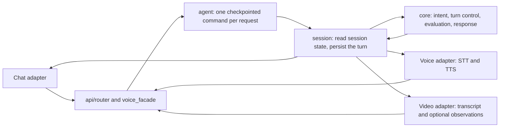

# Interview module architecture

The three interview modes share one assessment flow. Adapters normalize input and deliver output; they do not own question selection, turn decisions, or scoring.



The path of one candidate turn, as the code runs it (verified 2026-11-24):

```text
router / voice_facade
  → graph/runtime.run_interview_command("respond")
    → graph.InterviewCommandRunner.execute
                                             thread = (session, command, client_message_id); replay if completed
      → operations["respond"]              closure bound to the request's db session
        → session/chat_runtime.process_candidate_message
            build_session_state_from_db → CandidateTurnInput
            → agents.interviewer.graph.run_turn (turn graph and model decision)
              → core InterviewCoreEngine                  (guards, action handlers, output checks)
            persist messages, turn status, stage
```

Every modality submits the same ``core.contracts.interview.CandidateTurnInput``; there is
no second turn contract. The per-turn Interviewer Agent is separate from the durable
session-command workflow. ``agents/planner/PlannerAgent`` now owns prepare/freeze
orchestration and drafts the CV-grounded verification question. P1 planning,
CV project evidence, P2 selection, validation, and freeze modules now live in
``agents/planner/``. The deterministic entry gate is ``agents/planner/entry_gate.py``; job-level Question
Bank coverage/generation workflows live in ``question_bank/``. P2 no longer generates
Question Bank entries. A worker proposes review-only drafts from recorded gaps
after the session has closed and been scored.

For CV project evidence, P1 gives the Planner Agent the candidate's project
fields and job requirements through `submit_project_evidence`. The model may
propose claims and requirement links, but code accepts a claim only when its
quote is an exact substring of the matching CV project and its IDs are known.
Code scores and persists the validated evidence with the SQL plan. P2 reuses
that snapshot; no regex extractor or second model extraction pass remains.
Provider failure yields no structured project evidence and is traced.

For P1/P2, the Planner Agent may propose an ordering of code-derived competency
targets and select among code-filtered Question Bank candidates/feasible
subsets. The SQL-frozen Admin contract is included in both proposals. Code
validates each answer, enforces coverage/budget/uniqueness and freezes the
queue; invalid proposals use deterministic selection and are traced.
Planner orchestration is a compiled LangGraph. P1 uses the bounded
`rank_competency_targets` function tool; P2 uses a LangGraph tool loop with
read-only `search_question_bank` and validated
`submit_question_bank_selection` tools. The graph has no checkpoint because
the SQL plan and frozen queue are the durable state.

## Responsibilities

- `core/` owns behavior common to all modalities: turn state, evaluation rules, question response policy, and channel-neutral interviewer dialogue.
- `core/conversation/` owns the turn engine, response generation, and turn rules used for every modality.
- `core/contracts/` defines the shared interview input, output, stage, and action types.
- `core/session_policy/` defines the shared stage, timing, and demo-session rules.
- `core/dialogue/` owns shared dialogue policy, phrases, opening, language checks, playbook lessons, and speech-check diagnostics. It contains no STT, TTS, camera behavior, pronunciation, or audio recovery.
- `question_bank/` provides Question Bank coverage, generation, suggestions, insights and quality reporting; the deterministic entry gate is `agents/planner/entry_gate.py`.
- `graph/` runs the six session commands (`prepare`, `freeze`, `open`, `respond`, `finish`, `score`) on one compiled graph with a Postgres checkpoint per `(session, command, event)`. `InterviewCommandRunner` is workflow infrastructure, not an AI agent; operations arrive per call from `graph/runtime.py`.
- `agents/interviewer/` owns per-turn agent decision, menu, pacing, turn graph, decision record, and spoken-question drafting. `graph.py` is the graph entry point for one candidate turn; Core owns shared guards, action handlers, and output checks.
- `agents/planner/` owns P1 plan construction, CV project evidence, P2 selection/validation/freeze, prepare/freeze orchestration, and CV-grounded question drafting.
- `session/spoken_questions.py` persists validated spoken variants produced by the Interviewer Agent before the session opens.
- `question_bank/suggestions.py` queues Question Bank drafts for uncovered targets after close/score; drafts still require admin review.
- `graph/checkpoints.py` owns the Postgres checkpointer and the candidate-memory store lifecycle.
- Adapters normalise their input into `CandidateTurnInput` where they call the runtime. Voice accepts only a final transcript; partial STT is not an answer.
- Each modality package keeps `api/` transport only. The audio lifecycle lives in `realtime/`: the LiveKit worker, endpointing, interruption, `stt/`, `tts/`, `speech/` and `config/`. It owns transcription, transcript cleanup, answer buffering, audio turn taking, pronunciation, synthesis, and voice-only recovery phrases. Video observations remain telemetry unless an explicit assessment rule is added to Core.
- `session/` persists sessions and coordinates Core calls. `chat_runtime.py` is historically named; Voice and Video use this same runtime path.
- `admin/` reports settings, traces, and reviewed quality data. `progress/` owns candidate progress, calibration and skill summaries.
- `realtime/` owns the audio lifecycle: STT and TTS clients, the answer window, interruption, voice events and tuning. `adapters/voice/api/` keeps only transport.
- `memory/` owns LangMem retrieval and extraction; `blueprint/` owns the interview contract.

## Layout

```text
interviews/
|-- adapters/                  # transport only
|   |-- chat/api/              # router.py
|   |-- video_calls/api/       # router.py, signaling.py
|   `-- voice/api/             # router.py, Voice Lab endpoints
|-- realtime/                  # audio lifecycle (V2 spec §8)
|   |-- runtime.py             # LiveKit agent worker (the docker-compose entry point)
|   |-- endpointing.py         # when the candidate has finished speaking
|   |-- interruption.py        # barge-in
|   |-- events.py, health.py, voice_phrases.py
|   |-- stt/                   # provider.py, qwen.py, transcript.py, recognition.py
|   |-- tts/                   # provider.py, vieneu.py, cache.py, pronunciations_vi.py
|   |-- speech/                # language normalization and speech formatting
|   `-- config/                # voice tuning
|-- graph/                     # Main graph: the six commands
|   |-- graph.py               # command -> node dispatch, one compiled graph
|   |-- command_runner.py      # durable thread per (session, command, event)
|   |-- runtime.py             # run_interview_command: the entry point callers use
|   |-- ports.py, state.py
|   `-- checkpoints.py         # Postgres checkpointer + candidate-memory store
|-- agents/
|   |-- interviewer/           # graph.py (one-turn graph), thinker.py (the decider),
|   |                          # context.py, menu.py, pacing.py, tools.py, record.py,
|   |                          # state.py, spoken_questions.py
|   |-- planner/               # graph.py, prepare.py (P1), freeze.py (P2), selection.py,
|   |                          # evidence.py, entry_gate.py, planner.py, plan_structure.py
|   `-- evaluator/             # grading.py, report.py, rubric_grading.py, answer_outcome.py
|-- session/                   # business state and lifecycle
|   |-- chat_runtime.py        # shared persistence/runtime path for all three modalities
|   |-- text_runtime.py        # practice mode
|   |-- voice_facade.py, session_deadline.py, session_reaper.py, spoken_questions.py
|-- memory/                    # candidate_memory.py: store, seed, search tool, prompt
|                              # block, guard, langmem extractor
|                              # (rows in langmem's {kind, content} envelope)
|-- question_bank/             # coverage.py, generation.py, suggestions.py,
|                              # insights.py, quality.py
|-- blueprint/                 # service.py: interview types and versioned contracts
|-- progress/                  # candidate progress, calibration, skill summaries
|-- admin/                     # settings, traces, reviewed quality data, pipeline views
|-- core/
|   |-- conversation/          # turn_engine.py, response_generation.py, turn_rules.py
|   |-- contracts/             # interview.py
|   |-- session_policy/        # blueprint.py, demo_mode.py
|   |-- guardrails/            # input.py, output.py, common.py, llm_checks.py
|   `-- dialogue/              # policy.py, phrases.py, opening.py, playbook.py, speech_checks.py
|-- api/                       # router.py, blueprint_router.py, rate_limit.py
`-- facade.py                  # the public boundary for other modules
```

## Agent modes and flags (INTERVIEW_AGENT_DECISION_PLAN_V1)

| Env | Values | Effect |
|---|---|---|
| `INTERVIEW_AGENT_MODE` | `rule` (default) / `shadow` / `live` | `rule`: the rule ladder decides. `shadow`: the rule executes and the model choice is recorded. `live`: the model executes any valid action in the code-built menu; invalid, out-of-menu, or failed decisions fall back to the rule path. |
| `INTERVIEW_CANDIDATE_MEMORY` | `0` (default) / `read` / `readwrite` | `read`: seed from the gap notebook at `open`, load topics into the prompts, offer `search_candidate_memory` to the decider. `readwrite`: also extract after `score` with the `langmem` memory manager (extra `memory`); every model call it makes is an `ai_call_logs` row and the run is one Langfuse generation. |
| `INTERVIEW_UNIFIED_THINKER` | `0` (default) / `1` | Unified Thinker (V2 spec §6.2). The deciding call also returns the line the candidate hears, so an ordinary turn costs one provider call instead of two. Covers `acknowledge_and_probe`, `clarify_question`, `redirect_off_topic` and `answer_candidate_question`; `continue_warm_up` already worked this way. Each text passes that action's own output guard, and a rejected one falls back to generating the line, which costs the second call back but never the turn. `confirm_abort` and `close_interview` are deliberately left out: they happen at most once per session and usually arrive from an input guard, where there is no deciding call to carry the text. |

Every turn carries `metadata["decision"]` (menu, pacing, rule choice, model choice, agreement) and emits the `agent_decision` pipeline event; `scripts/eval/interviews/agent_shadow_report.py` reads them.

## V2 Phase 0 baseline (2026-11-26)

Measured before any restructuring, as INTERVIA_INTERVIEW_AGENT_V2_SPEC Phase 0
requires. These are facts about this HEAD, not targets.

| Question the spec asks | What the code does |
|---|---|
| Which mode runs? | Code default `rule`; the project `.env` sets `INTERVIEW_AGENT_MODE=live`. All three modes work. |
| LLM calls per turn | Input guard 0 · RULE 1 when the evaluator returns the probe in the same JSON, else 2 · LIVE 2 (decider + speech) · SHADOW 3. Counted by `tests/modules/interviews/agent/test_call_budget.py`. |
| Per-call latency | Already recorded: every call writes an `ai_call_logs` row with `duration_ms`, `purpose` and `model`. Percentiles come from that table. |
| Qwen STT | `STTCapabilities(streaming=True, interim_results=True)`; 1.0 s chunks, 0.8 s endpoint silence. Partial transcripts exist. |
| VieNeu TTS | `TTSCapabilities(streaming=False)`. No text-streaming API; audio arrives as an SSE byte stream per sentence, so progressive playback works and AC-12 needs no new API. |
| Endpointing | Fixed `COMMIT_SILENCE_SECONDS=1.8` / `SHORT_COMMIT_SILENCE_SECONDS=2.2`, env-tunable. Not adaptive. |
| Main graph | Already exists: `graph/graph.py` dispatches the six commands on one compiled graph with a Postgres checkpoint. |
| Video path | `adapters/video_calls/api/router.py::chat_voice_on_call` bypasses Core entirely (a bare `generate_text`). It and the chat/voice `chat` endpoints sit behind `legacy_interview_api_enabled`, **false** by default. |
| Luna / Talker | Not a separate service: an OpenAI model id (`gpt-5.6-luna`). `src/modules/ai/facade.py` now takes a per-call `model=`, so the Talker uses the existing provider (spec §1.1). Settings: `interview_talker_model` (empty = use `llm_model`) and `interview_talker_enabled` (**false**). |
| Broker for background work | RabbitMQ + Celery already configured; no new infrastructure is needed for §9. |

## Change rule

Change what the interviewer asks, how it handles an answer, or how it scores in Core so all modes behave consistently. Change an adapter only for transport, transcription, audio/video presentation, or channel-specific recovery. Remove a file only after checking imports, tests, scripts, and deployment entry points.
